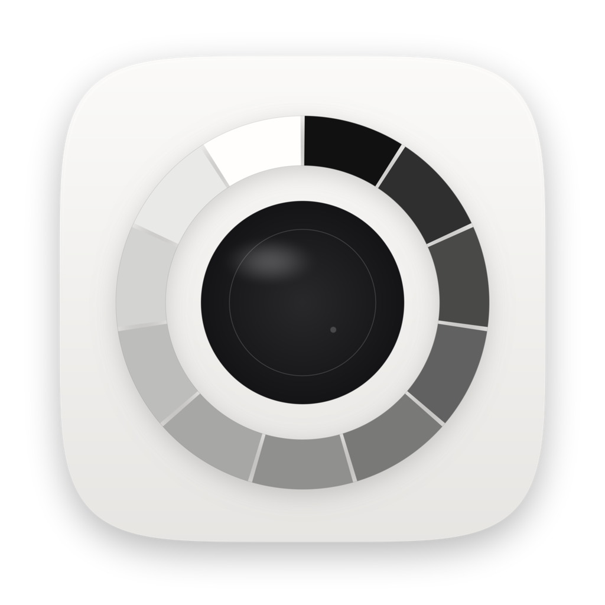

<p align="center">
  
</p>

<h1 align="center">Lumen</h1>

<p align="center">
  A lightweight Mac app for editing and color-grading your photos.<br>
  一款轻量的 Mac 修图调色软件。
</p>

<p align="center">
  <a href="#english">English</a> · <a href="#简体中文">简体中文</a> ·
  <a href="https://github.com/bodyzxy/Lumen/releases/latest">Download / 下载</a>
</p>

---

## English

### Download & install

1. Download **Lumen-1.0.0.pkg** from [Releases](https://github.com/bodyzxy/Lumen/releases/latest).
2. Double-click it and follow the installer. Lumen is installed into your **Applications** folder.
3. Open Lumen from Applications or Launchpad.

Requires macOS 14 or later on a Mac with Apple silicon.

**If macOS blocks the installer.** This build isn't notarized by Apple, so the first time you open the `.pkg`, macOS may say it can't verify it. Click **Done**, then open **System Settings → Privacy & Security**, scroll down and click **Open Anyway** next to the message about Lumen, and confirm. The installer then opens normally. You only need to do this once; the installed app opens without any warning.

### Build from source

```bash
git clone https://github.com/bodyzxy/Lumen.git
cd Lumen
bash run.sh          # build and run (release mode)
bash package.sh      # build the installer: dist/Lumen-1.0.0.pkg
```

Requires Xcode or the Command Line Tools.

Lumen uses only Apple's built-in frameworks (SwiftUI, Core Image, Metal) and has no third-party dependencies. The installed app is just a few megabytes.

### Run

```bash
cd Lumen
bash run.sh         # same as: swift run -c release Lumen
```

The first build takes 1–3 minutes. Always use release mode (`run.sh` does this); debug builds feel sluggish when dragging sliders.

If you see `permission denied`, run `chmod +x run.sh` once, or use `bash run.sh`.

### Language

The interface is available in **English** and **简体中文**. On first launch Lumen follows your system language. To switch:

- **View › Language**, or
- the **More (…)** menu in the toolbar, or
- **Lumen › Settings…** (⌘,)

The interface and every “?” explanation update right away.

### Design

- **Light and monochrome**, like a quiet sheet of photo paper. Hierarchy comes only from shades of ink; color appears only where it means color (temperature, hue, HSL).
- **Native three-column layout**: layers on the left, canvas in the middle, adjustments on the right. The system aligns the toolbar.
- **Glass buttons**: system materials with a specular rim, hairline border and soft shadow.
- **Square-edged inspector** with hairline dividers. Controls are organized into pages instead of one long scroll, and switching pages uses a “focus pull” transition.
- **Ruler sliders.** Every parameter is a tick-mark ruler:
  - drag anywhere on the row to adjust; hold ⌥ for fine control;
  - click a tick to jump to that value; double-click the name to reset;
  - the ticks swell like a magnifier under the needle while dragging, and the trackpad gives a light tap when you cross the default.
- **“?” on every parameter.** Hover to see, in plain words, what raising or lowering it does to the look of the photo.

### Animations

- **Develop** — a newly opened photo emerges from white, blurred and colorless, like a print in developer.
- **Light sweep** — a band of light passes over the photo when you apply a look.
- **Wipe compare** — holding “original” wipes the original in from left to right.
- **Living histogram** — the histogram flows smoothly as you adjust.
- **Loupe** — the white-balance and replace-color pickers show a 6× loupe with the color value.
- **Filmstrip morph** — switching photos morphs the image between its thumbnail and the canvas.

### Adjustments

**Basic** (always applied first, in five pages)

| Page | Controls |
|---|---|
| Light | Exposure, Contrast, Highlights, Shadows, Whites, Blacks |
| Color | White-balance picker, Temperature, Tint, Vibrance, Saturation |
| Texture | Texture, Clarity, Dehaze, Sharpening, Noise Reduction |
| Effects | Vignette, Grain, Grain Size |
| Calibrate | Shadow Tint; Hue and Saturation of the red, green and blue primaries |

**Adjustment layers** — everything in Photoshop's *Image › Adjustments* menu, plus two from Camera Raw:

| Group | Layers |
|---|---|
| Tone | Brightness/Contrast, Levels (draggable handles + Auto), Curves, Exposure |
| Color | Vibrance, Hue/Saturation, Color Balance, Black & White, Photo Filter, Channel Mixer, Color Lookup (.cube) |
| Special | Invert, Posterize, Threshold, Gradient Map (edit stops right on the bar), Selective Color |
| Light | Shadows/Highlights, HDR Toning |
| Image | Desaturate, Match Color, Replace Color (with picker), Equalize |
| Camera Raw | HSL Mixer, Color Grading (shadow, midtone, highlight and global wheels) |

The **Add adjustment** palette has a search field: just type and press Return to add the first match.

### Multiple photos

- Open several photos at once (multi-select or drag them in). Opening a new photo never replaces the one you're editing — it joins the **filmstrip** at the bottom, and each photo keeps its own adjustments and undo history.
- Click a thumbnail to switch photos.
- When you open a new photo and the previous one had edits, a banner asks whether to reuse them. **Apply** copies them over (and offers **Undo**); **Not Now** dismisses it.
- Right-click a thumbnail to apply the current adjustments to it, take its adjustments, sync to all photos, or close it.
- Copy / paste adjustments with ⇧⌘C / ⇧⌘V.

### Zoom

- **Trackpad**: pinch to zoom, two-finger scroll to pan.
- **Mouse**: scroll wheel zooms; hold ⌘ or ⌥ while scrolling to zoom as well.
- Drag the photo to pan when zoomed in (with a little inertia).
- Double-click the photo (or ⌘1) to toggle between *Fit* and *100%*.
- When zoomed in, the visible area is re-rendered from the full-resolution original, so detail stays sharp.

### Also

- Looks: six built-in looks previewed as thumbnails of *your* photo (shown once a photo is open)
- Split-view and hold-to-compare
- Histogram with luma / RGB modes and clipping warnings
- Undo / redo
- Save and load presets (JSON)
- Export JPEG, HEIC, PNG or 16-bit TIFF, at full size or a chosen long edge
- Export the color part of your grade as a `.cube` LUT
- Most camera RAW formats

### Keyboard shortcuts

| Action | Shortcut |
|---|---|
| Open photos | ⌘O |
| Export photo | ⌘E |
| Export LUT | ⇧⌘E |
| Save / load preset | ⌘S / ⌘L |
| Undo / redo | ⌘Z / ⇧⌘Z |
| Copy / paste adjustments | ⇧⌘C / ⇧⌘V |
| Split view | \ |
| Fit / 100% / zoom in / zoom out | ⌘0 / ⌘1 / ⌘= / ⌘- |
| Delete current layer | ⌘⌫ |
| Cancel picker | Esc |
| Settings | ⌘, |

### How it works

```
original → exposure, white balance (linear light) → highlights & shadows
         → texture, clarity, dehaze → noise reduction, sharpening
         → [LUT segment] → shadows/highlights or HDR → [LUT segment] → …
         → vignette → grain → output
```

Consecutive per-pixel adjustments are baked into one 64³ 3D LUT and applied on the GPU in a single pass, so stacking more layers barely affects speed. Adjustments that need neighboring pixels (Shadows/Highlights, HDR) split the stack into segments.

### Project layout

```
Lumen/
├── Package.swift
├── run.sh              build & run
├── package.sh          build the installer (.pkg)
├── publish.sh          push to GitHub & update the release
├── Packaging/
│   ├── AppIcon.icns        app icon
│   ├── make_icon.py        script that draws the icon
│   └── installer/          installer pages & background
└── Sources/Lumen/
    ├── LumenApp.swift      entry point, menus, shortcuts, settings, language switch
    ├── Localization.swift  Chinese / English switching
    ├── Model/              data model, multi-photo sessions, undo history, presets
    ├── Engine/             color math, LUTs, Core Image pipeline
    ├── Help/               “?” explanations (HelpTexts = Chinese, HelpTextsEN = English)
    ├── Resources/          app icon
    └── UI/
        ├── Theme.swift         colors, glass buttons, transitions
        ├── Instruments.swift   ruler sliders, pages, histogram, color wheel
        ├── ContentView.swift   window layout, toolbar, export
        ├── CanvasView.swift    canvas, zoom, filmstrip, animations, loupe
        ├── LayerSidebar.swift  layers, looks, add-adjustment palette
        ├── Inspector.swift     right-hand panel
        └── Panels/             pages for each adjustment
```

### The icon

A zone-system tone ring — eleven steps from pure black to pure white — around a lens, on a paper-white squircle. Regenerate it with `python3 Packaging/make_icon.py` (requires Pillow and NumPy).

---

## 简体中文

### 下载与安装

1. 从 [Releases](https://github.com/bodyzxy/Lumen/releases/latest) 下载 **Lumen-1.0.0.pkg**。
2. 双击它，按安装向导一步步操作，Lumen 会被安装到“**应用程序**”文件夹。
3. 在“应用程序”或启动台里打开 Lumen。

需要 macOS 14 或更新版本，以及 Apple 芯片的 Mac。

**如果系统拦截了安装包**：这个版本没有经过苹果公证，第一次打开 `.pkg` 时系统可能提示无法验证。先点**完成**，然后打开**系统设置 → 隐私与安全性**，往下拉，在关于 Lumen 的提示旁点**仍要打开**并确认，安装程序就能正常打开了。只需要操作一次，装好后的软件可以直接打开，不会再提示。

### 从源码编译

```bash
git clone https://github.com/bodyzxy/Lumen.git
cd Lumen
bash run.sh          # 编译并运行（release 模式）
bash package.sh      # 生成安装包：dist/Lumen-1.0.0.pkg
```

需要 Xcode 或 Command Line Tools。

Lumen 只使用苹果系统自带的框架（SwiftUI、Core Image、Metal），没有任何第三方依赖，安装后只有几 MB。

### 运行

```bash
cd Lumen
bash run.sh         # 等同于 swift run -c release Lumen
```

第一次编译需要 1～3 分钟。请用 release 模式运行（`run.sh` 已经设置好），debug 模式下拖动滑杆会卡。

如果提示 `permission denied`，先执行一次 `chmod +x run.sh`，或者改用 `bash run.sh`。

### 语言

界面支持 **English** 和 **简体中文**。第一次启动时跟随系统语言。切换方法（任选一种）：

- 菜单栏 **视图 › 语言**
- 工具栏的 **更多（…）** 菜单
- **Lumen › 设置…**（⌘,）

切换后，界面文字和所有“?”说明都会立即更新。

### 设计

- **浅色、单色调**，像一张安静的相纸。层级只靠墨色深浅区分；彩色只出现在真正代表颜色的地方（色温、色相、HSL）。
- **原生三栏布局**：左边是图层，中间是画布，右边是调整面板。工具栏由系统负责对齐。
- **玻璃按钮**：系统材质，加上顶部高光描边、发丝线和柔和投影。
- **直角的调整面板**，用发丝线分隔。参数按页组织，不用一直往下滑；翻页时有“对焦”转场。
- **刻度尺滑杆**：每个参数是一条刻度尺。
  - 在整行任意位置左右拖动就能调整，按住 ⌥ 是微调；
  - 单击刻度直接跳到那个值，双击参数名恢复默认值；
  - 拖动时指针附近的刻度会像放大镜一样隆起，经过默认值时触控板会轻轻震一下。
- **每个参数都有“?”**：鼠标停一下，就会用大白话说明调大、调小对画面感觉的影响。

### 动画

- **显影**：新打开的照片像相纸在显影液里一样，从发白、失焦、无色慢慢浮现。
- **扫光**：套用风格时，一道光从画面上扫过。
- **擦除对比**：按住“看原图”时，原图从左往右擦出来。
- **流动直方图**：调整参数时，直方图会平滑地流动变形。
- **吸管放大镜**：白平衡吸管和替换颜色吸管会出现 6 倍放大镜，并显示色值。
- **胶片条形变**：切换照片时，照片会在缩略图和画布之间形变过渡。

### 调整功能

**基础调整**（始终最先计算，分 5 页）

| 页面 | 参数 |
|---|---|
| 光影 | 曝光、对比度、高光、阴影、白色、黑色 |
| 色彩 | 白平衡吸管、色温、色调、自然饱和度、饱和度 |
| 质感 | 纹理、清晰度、去朦胧、锐化、降噪 |
| 效果 | 暗角、颗粒、颗粒大小 |
| 校准 | 阴影色调；红、绿、蓝三原色的色相和饱和度 |

**调整图层**：Photoshop「图像 › 调整」菜单里的全部调色项，外加 Camera Raw 的两项。

| 分组 | 图层 |
|---|---|
| 明暗 | 亮度/对比度、色阶（可拖动三角滑块，带“自动”）、曲线、曝光度 |
| 色彩 | 自然饱和度、色相/饱和度、色彩平衡、黑白、照片滤镜、通道混合器、颜色查找（.cube） |
| 特殊 | 反相、色调分离、阈值、渐变映射（直接在渐变条上编辑色标）、可选颜色 |
| 影调 | 阴影/高光、HDR 色调 |
| 图像 | 去色、匹配颜色、替换颜色（带吸管）、色调均化 |
| Camera Raw | HSL 混色器、颜色分级（阴影、中间调、高光、全局四个色轮） |

“添加调整”面板顶部有搜索框：直接打字筛选，按回车添加第一项。

### 多张照片

- 可以一次打开多张照片（多选或直接拖入）。打开新照片不会覆盖正在编辑的那张，它会进入底部的**胶片条**，每张照片都保留自己的调整和撤销历史。
- 点缩略图即可切换照片。
- 打开新照片时，如果上一张有调整，顶部会询问是否沿用：点**应用**套用（之后还可以点**撤销**），点**不用**就忽略。
- 在缩略图上右键，可以：
  - 把当前调整应用到这张
  - 沿用这张的调整
  - 同步到全部照片
  - 关闭这张照片
- 拷贝 / 粘贴调整：⇧⌘C / ⇧⌘V。

### 缩放

- **触控板**：双指捏合缩放，双指滑动平移。
- **鼠标**：滚轮缩放；按住 ⌘ 或 ⌥ 滚动也可以缩放。
- 放大后可以直接拖动照片，松手带一点惯性。
- 双击照片（或按 ⌘1）在“适应窗口”和“100%”之间切换。
- 放大后会按原图分辨率重新渲染你看到的区域，细节清晰。

### 其他

- 风格：6 种内置风格，直接用**你的照片**生成缩略图预览（打开照片后显示）
- 左右对比、按住看原图
- 直方图：亮度 / RGB 两种模式，并提示暗部和高光溢出
- 撤销 / 重做
- 保存、载入预设（JSON）
- 导出 JPEG、HEIC、PNG、16 位 TIFF，可选原尺寸或指定长边
- 把调色的颜色部分导出为 `.cube` LUT
- 支持大部分相机 RAW 格式

### 快捷键

| 操作 | 快捷键 |
|---|---|
| 打开照片 | ⌘O |
| 导出照片 | ⌘E |
| 导出 LUT | ⇧⌘E |
| 保存 / 载入预设 | ⌘S / ⌘L |
| 撤销 / 重做 | ⌘Z / ⇧⌘Z |
| 拷贝 / 粘贴调整 | ⇧⌘C / ⇧⌘V |
| 左右对比 | \ |
| 适应 / 100% / 放大 / 缩小 | ⌘0 / ⌘1 / ⌘= / ⌘- |
| 删除当前图层 | ⌘⌫ |
| 取消吸管 | Esc |
| 设置 | ⌘, |

### 工作原理

```
原图 → 曝光、白平衡（线性空间）→ 高光与阴影
     → 纹理、清晰度、去朦胧 → 降噪、锐化
     → [LUT 段] → 阴影/高光 或 HDR → [LUT 段] → …
     → 暗角 → 颗粒 → 输出
```

连续的逐像素调整会合成一张 64³ 的 3D LUT，在 GPU 上一次完成，所以叠再多图层速度也几乎不变。阴影/高光、HDR 这类需要参考周围像素的调整，会把图层栈切成几段分别处理。

### 目录结构

```
Lumen/
├── Package.swift
├── run.sh              编译并运行
├── package.sh          生成安装包（.pkg）
├── publish.sh          推送到 GitHub 并更新 Release
├── Packaging/
│   ├── AppIcon.icns        软件图标
│   ├── make_icon.py        生成图标的脚本
│   └── installer/          安装向导的页面和背景
└── Sources/Lumen/
    ├── LumenApp.swift      入口、菜单、快捷键、设置、语言切换
    ├── Localization.swift  中英文切换
    ├── Model/              数据模型、多照片、撤销历史、预设
    ├── Engine/             调色算法、LUT、Core Image 渲染管线
    ├── Help/               “?”说明文案（HelpTexts 为中文，HelpTextsEN 为英文）
    ├── Resources/          软件图标
    └── UI/
        ├── Theme.swift         颜色、玻璃按钮、转场
        ├── Instruments.swift   刻度尺滑杆、分页、直方图、色轮
        ├── ContentView.swift   窗口布局、工具栏、导出
        ├── CanvasView.swift    画布、缩放、胶片条、动画、放大镜
        ├── LayerSidebar.swift  图层、风格、添加调整面板
        ├── Inspector.swift     右侧调整面板
        └── Panels/             各调整的参数页
```

### 图标

纸白色的圆角方形上，一圈“区域曝光”色阶环（从纯黑到纯白共 11 级）围绕着一枚镜头。可以用 `python3 Packaging/make_icon.py` 重新生成（需要 Pillow 和 NumPy）。
